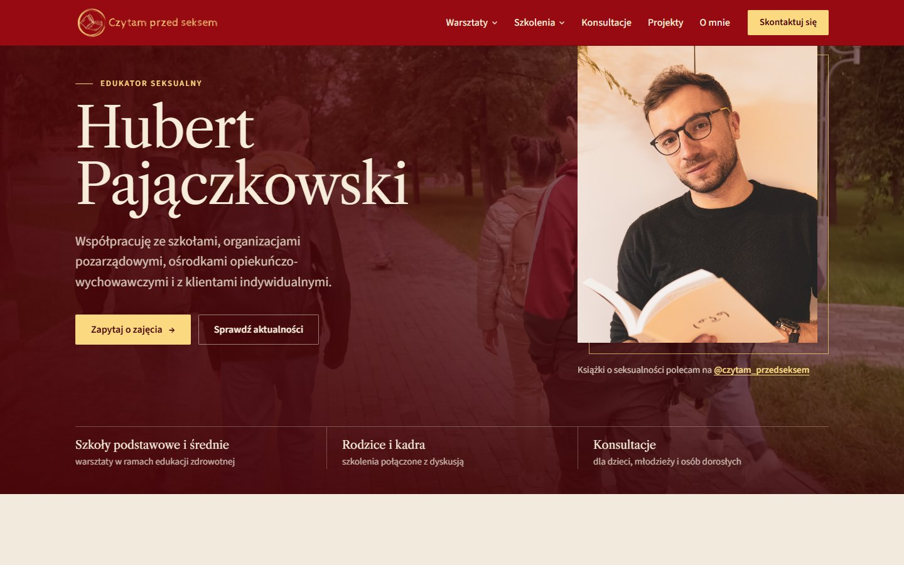
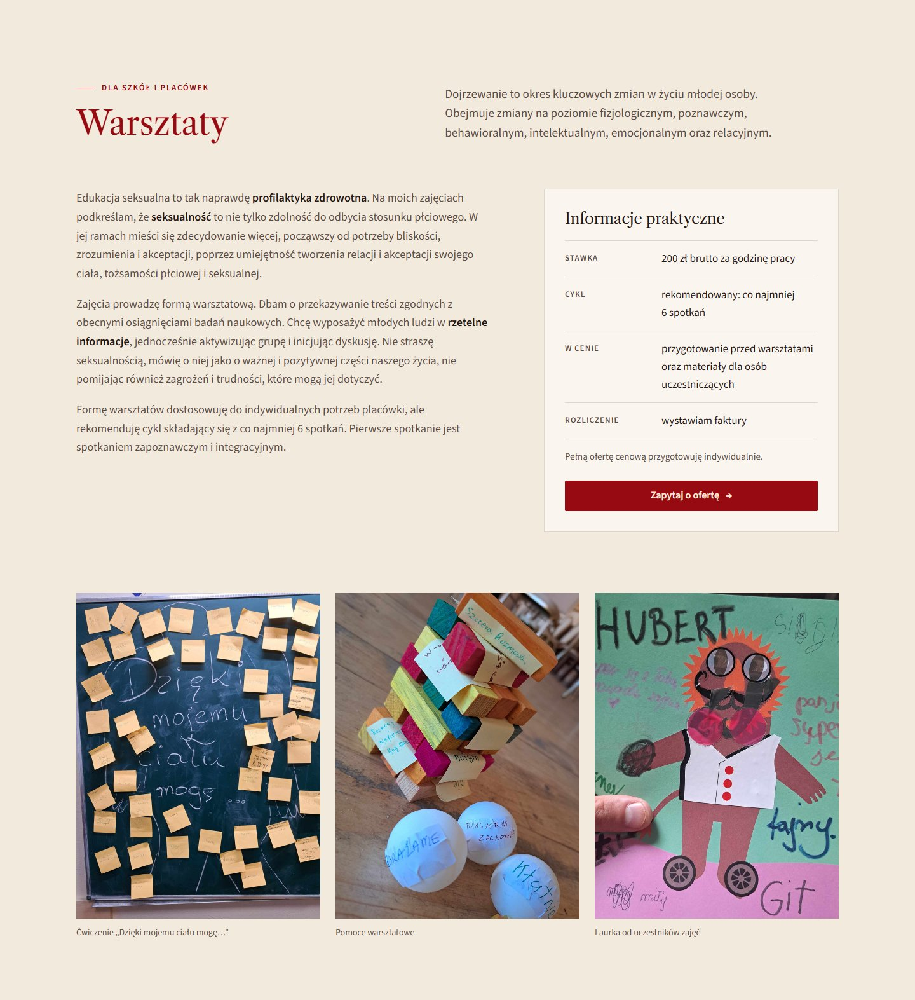
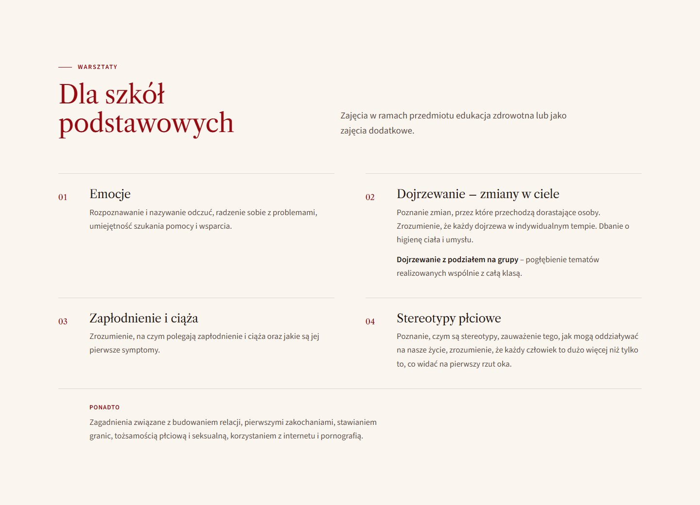
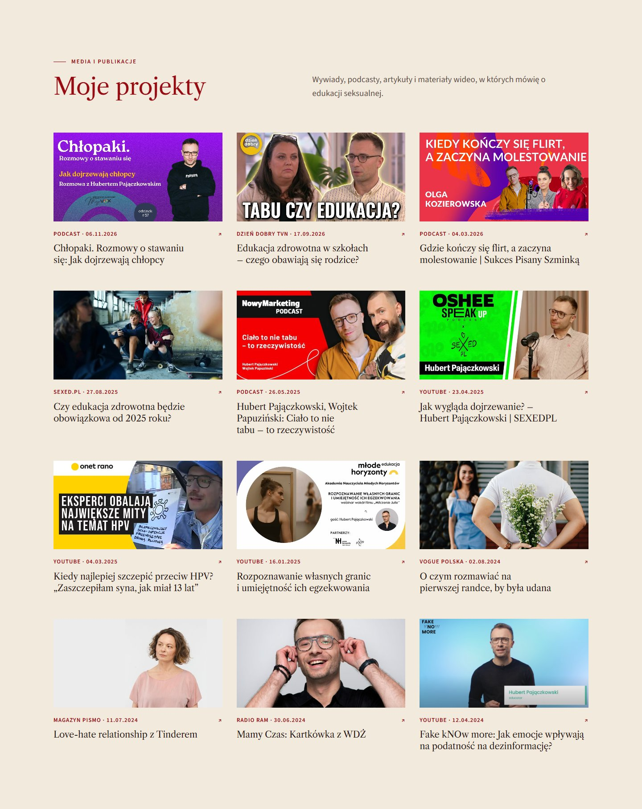
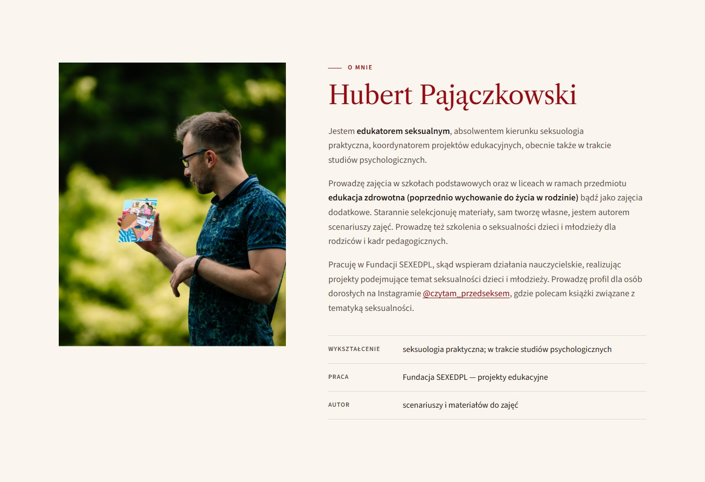
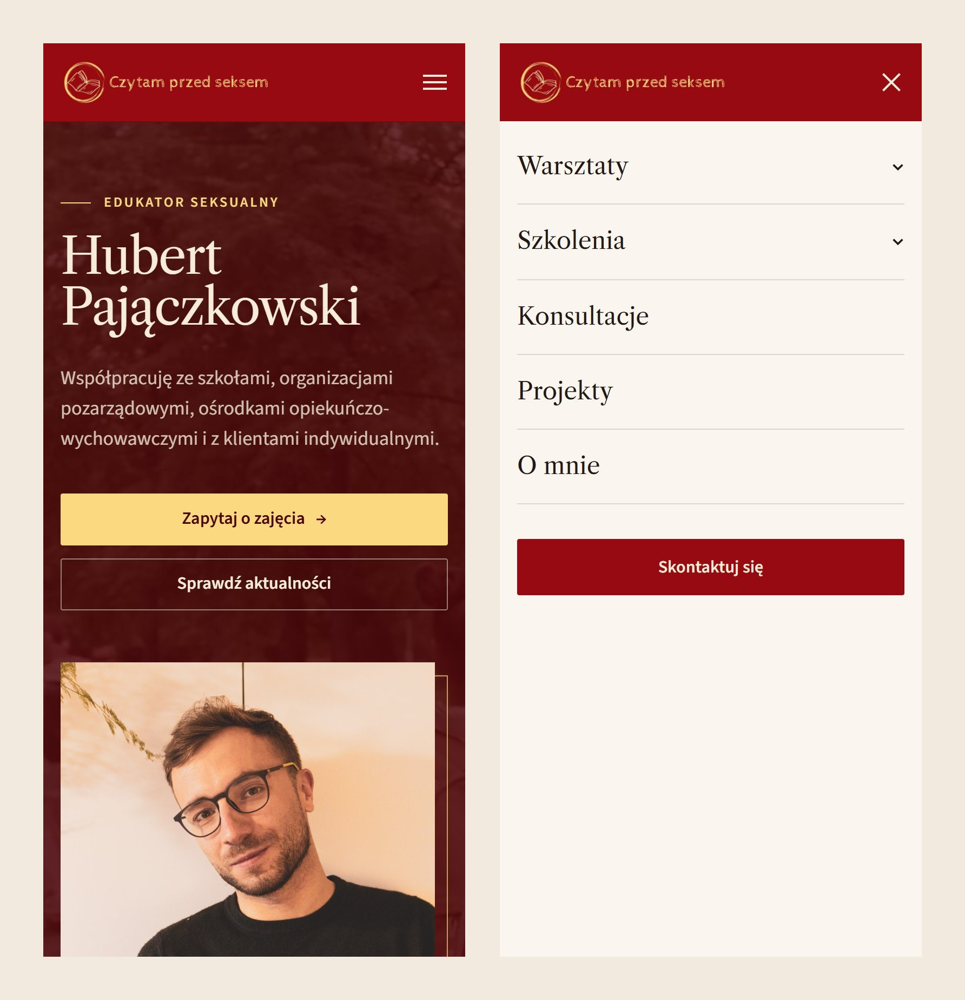

<p align="center">
    
</p>

<p align="center">
    Website of <strong>Hubert Pajączkowski</strong> – sexual educator, graduate in practical sexology and psychology student.
    The site presents workshops for primary and secondary schools, training sessions for parents and teaching staff,
    individual consultations and media projects (interviews, podcasts, articles).
</p>

<p align="center">
    <a href="https://www.czytamprzedseksem.pl/"><strong>www.czytamprzedseksem.pl</strong></a>
</p>



## Table of contents

- [Technologies](#technologies)
- [Sections](#sections)
- [Getting started](#getting-started)
- [Project structure](#project-structure)
- [Adding a new project](#adding-a-new-project)
- [Production build and deployment](#production-build-and-deployment)
- [Screenshots](#screenshots)
- [License](#license)

## Technologies

- [Next.js 14](https://nextjs.org/) (Pages Router, static export)
- React 18
- TypeScript
- SASS/SCSS
- Google Fonts: Libre Caslon Text (headings) and Source Sans 3 (body text)

## Sections

The site is a single page made of these sections:

| Section | Anchor | Component |
| --- | --- | --- |
| Hero | `#hero` | `Hero.tsx` |
| Workshops – practical info and photos | `#warsztaty` | `Workshops.tsx` |
| Primary school program | `#dla-szkol-podstawowych` | `PrimarySchoolWorkshops.tsx` |
| Secondary school program | `#dla-szkol-srednich` | `HighSchool.tsx` |
| Parents and teaching staff, consultations | `#spotkania-z-rodzicami-i-kadra-pedagogiczna`, `#konsultacje` | `Courses.tsx` |
| My projects (media) and educational shorts | `#moje-projekty` | `News.tsx` |
| Partners | `#wspolpraca` | `Cooperation.tsx` |
| About me | `#o-mnie` | `AboutMe.tsx` |
| Contact | `#skontaktuj-sie` | `Contact.tsx` |

## Getting started

```bash
npm install
npm run dev
```

Open [http://localhost:3000](http://localhost:3000) in your browser.

## Project structure

```
public/
  img/            images (news thumbnails, photos, partner logos, portraits)
  movie/          hero background video
src/
  components/
    common/       Header, Footer, TopicList (numbered program topics)
    sections/     one component per page section
  pages/          index.tsx (page layout), _document.tsx (meta tags, fonts)
  sass/
    global/       variables (colors, breakpoints), reset, global styles
    common/       layout, header, footer, buttons
    sections/     styles for each section
    main.scss     entry point
```

## Adding a new project

Media projects live in the `PROJECT_LIST` array in [`src/components/sections/News.tsx`](./src/components/sections/News.tsx).

1. Save the thumbnail in `public/img/news/` (for YouTube videos: `https://i.ytimg.com/vi/<VIDEO_ID>/maxresdefault.jpg`).
2. Import it at the top of `News.tsx`.
3. Add an entry anywhere in `PROJECT_LIST`:

```tsx
{
  href: "https://www.youtube.com/watch?v=...",
  image: newsImg13,
  title: "Project title",
  source: "Podcast",   // e.g. YouTube, Podcast, Dzień Dobry TVN, Vogue Polska
  date: "2026-11-06",  // publication date, YYYY-MM-DD
},
```

Projects are sorted by `date` automatically (newest first), and the date is shown on the card as `DD.MM.YYYY`.

## Production build and deployment

The project uses static export (`output: 'export'` in [`next.config.js`](./next.config.js)), so a single command builds the whole site into plain HTML/CSS/JS:

```bash
npm run build    # outputs the static site to out/
```

To deploy, upload the contents of the `out/` directory to the hosting server (e.g. via FTP).

> `npm run export` (`next export`) no longer works – the command was removed in Next.js 14. `npm run build` already creates `out/`.

## Screenshots

### Desktop

**Workshops**



**Primary school program**



**My projects**



**About me**



### Mobile



## License

License Creative Commons Non-Commercial (CC BY-NC) License 

This work is licensed under a Creative Commons Non-Commercial (CC BY-NC) License (not for commercial use).
